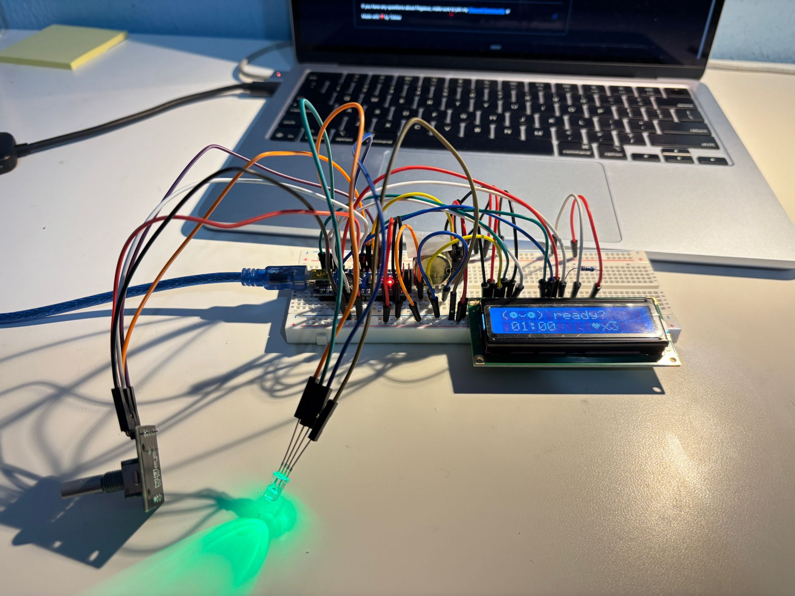

# Desk Pet Pomodoro

A tiny desk pet that lives on a 16x2 LCD and keeps you focused. It works as a Pomodoro timer with a face: it looks serious while you work, cheers up on breaks, blinks now and then, and falls asleep if you ignore it.

Built on an Arduino Nano with a rotary encoder, an RGB LED and a buzzer.



**[Try it without hardware](https://claude.ai/artifact/SANz35iexcV5LpH7PQzdpn):** an interactive model of the pet that runs the same logic as the sketch. You can turn and press the knob, speed up time to 60×, and hear the beeps. An offline copy is in [`model/index.html`](model/index.html); download it with the `images` folder.

## 3D models

Interactive 3D pages you can spin and zoom. Click a name to open it in your browser. Offline copies are in the [`3d`](3d) folder; they load three.js from a CDN, so they still need an internet connection.

| Model | What it shows |
|---|---|
| [Breadboard circuit](https://claude.ai/artifact/VtPYkK65fCz4SG4bsrE5wC) | The full circuit on an 830-point breadboard, built step by step with every hole named (like `b16`). The LCD lies flat in row a and hangs off the front edge, so it faces you. The back rails carry power for the screen. |
| [Enclosure concept](https://claude.ai/artifact/C8XS41Bc4vuAf5zvahWdsq) | A concept 3D-printed shell with a tilted face, knob, LED and speaker grille. You can change the PLA color and look inside. These are rough sizes, not a print file. |

## Features

- Focus timer you set with a knob (1–60 minutes, 25 by default)
- Automatic 5-minute break after each focus session
- Pet face drawn with custom LCD characters: focused, happy, paused, sleepy, plus random blinks
- RGB LED shows the state: green for focus, blue for break, amber for paused, white for ready, off when asleep
- Beeps to mark a start, the end of focus (3 beeps) and the end of a break (2 beeps)
- Heart counter of finished focus sessions
- Non-blocking code: no `delay()`, so the knob always responds

## Parts

| Part | Notes |
|---|---|
| Arduino Nano | Clones with a CH340 USB chip work fine |
| LCD1602 | Parallel (non-I2C) version |
| 10k potentiometer | Sets LCD contrast |
| KY-040 rotary encoder | With push button |
| RGB LED module | Common cathode (see below for common anode) |
| Buzzer | Passive sounds best; active also works |
| Breadboard and jumper wires | |

## Wiring

| Part | Pin | Nano |
|---|---|---|
| LCD | RS | D12 |
| LCD | E | D11 |
| LCD | D4 | D5 |
| LCD | D5 | A0 |
| LCD | D6 | A1 |
| LCD | D7 | A2 |
| LCD | VSS, RW, K | GND |
| LCD | VDD, A | 5V |
| LCD | V0 | Potentiometer middle leg (outer legs to 5V and GND) |
| Encoder | CLK | D2 |
| Encoder | DT | D4 |
| Encoder | SW | A3 |
| Encoder | +, GND | 5V, GND |
| Buzzer | + | D3 |
| RGB LED | R, G, B | D9, D10, D6 |
| RGB LED | Common | GND |

## Controls

| Action | When | Result |
|---|---|---|
| Turn knob | Ready | Change focus minutes |
| Short press | Ready | Start focus |
| Short press | Focus or break | Pause |
| Short press | Paused | Resume |
| Hold 1 s | Any time | Reset to ready |

After 60 seconds idle on the ready screen, the pet falls asleep. Turn or press the knob to wake it.

## Build and upload

With the [Arduino IDE](https://www.arduino.cc/en/software), open `desk_pet.ino`, pick **Arduino Nano** as the board, and upload. Install the **LiquidCrystal** library if the IDE asks for it.

With [arduino-cli](https://arduino.github.io/arduino-cli/):

```bash
arduino-cli core install arduino:avr
arduino-cli lib install LiquidCrystal
arduino-cli compile --fqbn arduino:avr:nano .
arduino-cli upload -p <your-port> --fqbn arduino:avr:nano .
```

Run `arduino-cli board list` to find the port. If the upload fails on an older clone, use `arduino:avr:nano:cpu=atmega328old` as the board.

Arduino expects the sketch to sit in a folder with the same name, so keep the folder called `desk_pet`.

## Tweaks

- **Knob turns the wrong way:** swap `1` and `-1` in `handleEncoder()`.
- **Common-anode LED:** wire the common pin to 5V and use `255 - value` in `setColor()`.
- **Blank LCD or solid blocks:** turn the contrast potentiometer.
- **Break length or sleep delay:** change `BREAK_MIN` and `SLEEP_AFTER_MS` at the top of the sketch.

## License

[MIT](LICENSE)
